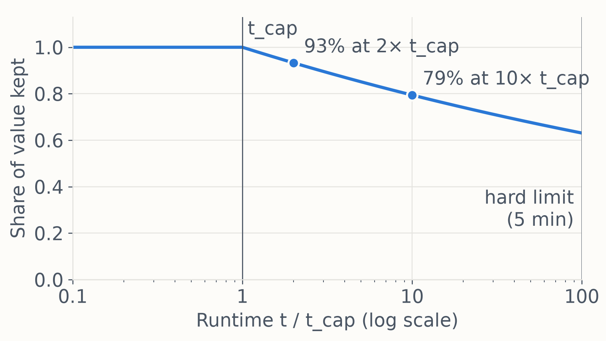

# QEC decoder hackathon, November 2026: build your own decoder

This repository holds the tools for the QEC decoder hackathon. The competition itself runs on Kaggle (invite only); the link to the competition will be added here later. On Kaggle you download the data, submit predictions and follow the leaderboard. Where this README and the Kaggle pages differ, the Kaggle pages count.

## Description

The goal of this competition is to build a decoder for the `[[18,4,4]]` qLDPC code presented experimentally in [Wang et al. (2026)](https://doi.org/10.1038/s41567-025-03157-4), under SI1000 circuit-level noise ([Gidney et al. (2021)](https://doi.org/10.22331/q-2021-12-20-605)).

Circuit-level noise means that every quantum gate, measurement and reset can fail with some small probability. For the SI1000 noise model these errors are:

| Operation | Error | Technical term |
| --- | --- | --- |
| Single-qubit gate | A random Pauli error ($X$, $Y$ or $Z$) on the qubit with probability $p/10$ after the gate | $\text{Depolarization}_1(p/10)$ |
| Two-qubit gate (CZ) | A random non-identity two-qubit Pauli error (one of 15) on the qubit pair with probability $p$ after the gate | $\text{Depolarization}_2(p)$ |
| Reset | The qubit is prepared in the wrong state (bit flip, $X$) with probability $2p$ after the reset | $\text{Bit flip}(2p)$ |
| Measurement | The measurement outcome is flipped with probability $5p$ | $\text{Bit flip}(5p)$ |
| Idle qubit | A random Pauli error with probability $p/10$ for each layer of gates the qubit is not used in | $\text{Depolarization}_1(p/10)$ |
| Idle qubit during measurement or reset | A random Pauli error with probability $2p$ for each measurement or reset layer the qubit is not used in | $\text{Depolarization}_1(2p)$ |

In this competition $p = 0.002$, and every experiment runs 5 rounds of error correction.

The code is an `[[n,k,d]]` = `[[18,4,4]]` code. It has $n=18$ data qubits (32 qubits including the check qubits), $k=4$ logical qubits and code distance $d=4$: at least four errors are needed to create an undetectable logical error. Under circuit-level noise, the circuit used here reduces the distance from 4 to 3; see [Wang et al. (2026)](https://doi.org/10.1038/s41567-025-03157-4) for details.

### Prize

The winning team is invited on a trip to Copenhagen to visit the Novo Nordisk Foundation Quantum Computing Programme (NQCP) at the Niels Bohr Institute, University of Copenhagen.

See the Rules on Kaggle for who can receive the prize, what the trip covers and the other terms.

## The decoding problem

If you are new to quantum error correction, you can think of the decoding problem in a simplified way.

Every error that can occur in the circuit can be turned into a binary event: either an error occurred at a given location or it didn't. Each location has a probability that an error occurred. The binary vector saying whether an error occurred at each location is denoted $e$, and the **probability vector** is denoted $p$. In a single shot, $e_i\sim\text{Bernoulli}(p_i)$, so it is 1 with probability $p_i$.

The error vector $e$ is hidden. Instead you see the detector events $D$, also a vector. The relation between $e$ and $D$ is given by a binary parity **check matrix** $H$:

$$D = He \mod 2$$

Your task is to predict, from $D$, which logical qubits had an error. This is the logical observable vector $O$, which is related to $e$ by a binary **observable matrix** $L$:

$$O = Le \mod 2$$

You can get $H$, $L$ and $p$ from a circuit file with `problem_info` from this repository's package. Error mechanisms with the same effect are merged into one column, so every column is unique:

```python
import stim
from hackathon_2026 import problem_info

circuit = stim.Circuit.from_file("data/test_set/X_circuit.stim")
metadata = problem_info(circuit)
metadata["H"]  # parity check matrix (detectors x mechanisms)
metadata["L"]  # observable matrix (observables x mechanisms)
metadata["p"]  # probability of each mechanism
```

## Decoder ideas

**Lookup-table (LUT) decoder.** A LUT decoder goes through a lot of example data and records the correct answer $O$ for each set of detector events $D$ it sees. When decoding, it uses this table to guess the answer. You will have to decide what the output $\hat O$ should be for a $D$ that isn't in the table: should it assume no logical errors occurred, or is there a better way to come up with an answer? You can generate as much training data as you need (see [Generating more data](#generating-more-data)).

**Belief propagation (BP) decoder.** A BP decoder works directly with the decoding problem described above. It passes messages back and forth on the graph defined by the check matrix $H$, starting from the prior probabilities $p$, to estimate how likely each error $e_i$ is given the observed detector events $D$. If the most likely error $\hat e$ it finds satisfies $H\hat e = D \mod 2$, the prediction is simply $\hat O = L\hat e \mod 2$. Unlike the LUT and ML decoders, BP needs no training data, but it does not always converge. You will have to decide what to do when it doesn't. Can you use the probabilities BP produces to construct a valid $\hat e$ yourself (for example by solving $H\hat e = D \mod 2$ while preferring the most likely errors), or should you fall back on another decoder? A tutorial on the core BP logic is in [the tutorial project notebook](notebooks/tutorials/Project.ipynb). It uses *PyMatching* as a fallback, which is not allowed in this competition, so you will have to replace that part.

**Machine learning (ML) decoder.** An ML decoder is a powerful and versatile way to build a decoder tailored to a specific code, and you are free to choose the architecture. You can generate as much training data as you need (see [Generating more data](#generating-more-data)).

Whatever you build, you must write the decoder yourself: see [Rules](#rules) for which libraries are allowed. For a gentler introduction to QEC, see [the tutorial class exercise notebook](notebooks/tutorials/InClassExercises.ipynb), taken from the [Large Scale Simulation of Quantum Systems](https://kurser.ku.dk/course/NFYK26002U) course at the University of Copenhagen.

## Data

Download the two problem folders from the Data tab on Kaggle and put them in `data/`, so you have `data/kaggle_public/` and `data/kaggle_private/`. A third, labelled folder ships with this repository. All three were made by [`data/generate_data.py`](data/generate_data.py) with the same circuits and settings:

- **`data/kaggle_public/`** (from Kaggle) - 200,000 shots (100,000 X basis, then 100,000 Z basis) **without labels**. Your predictions for these are scored on the Public leaderboard.
- **`data/kaggle_private/`** (from Kaggle) - 200,000 more shots in the same format, **without labels**. Your predictions for these are scored on the Private leaderboard, which decides the ranking.
- **`data/test_set/`** (in this repository) - 200,000 **labelled** shots (100,000 per basis), sampled with a fixed seed, to check your decoder locally.

There are two experiments, the X-basis memory experiment and the Z-basis memory experiment. Each has its own circuit: decode X rows with the X circuit and Z rows with the Z circuit.

### Files

Each folder holds:

- **`<folder name>.csv`** (e.g. `kaggle_public.csv`) - one row per shot (columns below)
- **X_circuit.stim**, **Z_circuit.stim** - the noisy circuits for the two experiments, in [Stim](https://github.com/quantumlib/Stim) format. They define the detectors, the observables and the probability of every error. The circuits are identical in all three folders.
- **args.json** - the settings `data/generate_data.py` was run with

### Columns

- `id` - shot identifier of the form `gen_<basis>_<index>`, e.g. `gen_X_00042`. Ids are unique within a folder, but the same ids appear in every folder, so keep the predictions for each folder in their own file.
- `basis` - `X` or `Z`: which experiment the shot comes from, and so which circuit to decode it with.
- `D0` to `D69` - detector events, each 0 or 1. Column `Di` is detector `i` in the circuit file. A 1 means the detector fired, i.e. a check disagreed with its previous value, which signals an error nearby in space and time. The detectors are ordered in time:
  - `D0` to `D6`: round 0 (only the 7 checks in the experiment's own basis have a known starting value)
  - `D7` to `D62`: rounds 1 to 4, 14 checks each
  - `D63` to `D69`: the final measurement of the data qubits

  `circuit.get_detector_coordinates()` gives each detector's (x, y, t) coordinates, where t is the time step from 0 to 5.
- `L0` to `L3` - **only in `data/test_set/test_set.csv`; these are the targets.** Logical observable flips, each 0 or 1. A 1 means errors flipped that logical observable by the end of the experiment.

### Generating more data

You may generate as much extra data as you like. Stim can sample any number of labelled shots from the circuit files:

```python
import stim

circuit = stim.Circuit.from_file("data/test_set/X_circuit.stim")
detectors, observables = circuit.compile_detector_sampler().sample(100_000, separate_observables=True)
```

To write a new labelled set in the same format as `data/test_set/`, run from the repository root:

```bash
python data/generate_data.py data/generated/ --shots 100000 --seed 1
```

The output folder gets `<folder name>.csv`, the two circuits and `args.json`; **any files already in that folder are deleted first**. It rebuilds the competition's circuits by default; `--rounds` and `--noise-probability` change the settings. To build circuits with other settings in Python, for example a different noise strength for training, use the package:

```python
from hackathon_2026 import apply_circuit_noise, create_circuit, test_dataset

circuit = apply_circuit_noise(create_circuit("X", 5), p=0.003)  # basis, rounds; SI1000 noise strength
detector_events, observable_flips = test_dataset(circuit, shots=100_000)
```

## Evaluation

The decoder takes the detector events $D$ and predicts the observable flips $\hat O$. The logical error rate (LER), the fraction of wrong predictions, is

$$\text{LER} = \frac{1}{N_\text{trials}}\sum_{i=1}^{N_\text{trials}}\frac{1}{k}\sum_{j=1}^k\left[O_j^{(i)}\neq\hat O_j^{(i)}\right]$$

where $N_\text{trials}$ is the number of shots, $k=4$ is the number of logical qubits, and $[\cdot]$ is 1 if the statement inside is true and 0 otherwise. Every logical qubit of every shot counts separately: a shot where 2 of the 4 predictions are wrong counts as half a failure.

On the leaderboard, submissions are scored with the mean absolute error (MAE) between your predictions and the true flips, over every shot and observable. With 0/1 predictions this is exactly the LER. **Lower is better.** X and Z shots count equally. Predicting all zeros already gives an LER of about 0.29.

### Submission file

You submit **two separate files**: one for `data/kaggle_public/` and one for `data/kaggle_private/`. Each file has a row for every `id` in that folder's CSV, with the four predicted observable flips `L0` to `L3`, each 0 or 1. Each file needs a header row and the columns `id, L0, L1, L2, L3` **in exactly that order**. The metric matches columns by position, not by name. `save_submission` and `submission_template/run_local.py` write this format for you.

```
id,L0,L1,L2,L3
gen_X_00000,0,0,0,0
gen_X_00001,0,0,0,0
...
```

You may make at most 10 submissions per day, and select up to [2] final submissions.

### Final ranking: accuracy and speed

A good decoder must also be fast, so the final ranking is decided in three steps.

**Step 1: accuracy.** The leaderboard ranks every submission by its LER. When the competition closes, the top 10 teams on the Private leaderboard go through to step 2. All other teams keep their Private leaderboard order.

**Step 2: accuracy and speed.** The top 10 teams hand in their decoder (see [Handing in your code](#handing-in-your-code)). We run it on our timing machine, one NVIDIA B200 GPU with 48 CPU cores and the same for every team, and measure its runtime $t$: the total wall-clock time to decode all test shots, X and Z, taking the median of 5 runs. These teams are then ranked by

$$\text{final score} = \text{LER} \times \max\left(1, \frac{t}{t_\text{cap}}\right)^{\alpha}$$

where LER is the team's Private leaderboard score. Lower is better.

The target runtime $t_\text{cap}$ is the runtime of our own reference decoder on the same machine: provisionally **3 s**, to be updated once we have benchmarked it on the timing machine. A decoder that finishes within $t_\text{cap}$ keeps its full value: its final score is just its LER. Beyond the cap, the decoder keeps only a share $(t_\text{cap}/t)^{\alpha}$ of its value, so every doubling of the runtime multiplies its final score by $2^{\alpha}$. We use $\alpha = 0.1$, so each doubling costs about 7%:



| Runtime | Score multiplier | Value kept |
| --- | --- | --- |
| up to $t_\text{cap}$ | ×1.00 | 100% |
| $2\,t_\text{cap}$ | ×1.07 | 93% |
| $10\,t_\text{cap}$ | ×1.26 | 79% |
| $100\,t_\text{cap}$ | ×1.58 | 63% |

Accuracy and runtime go hand in hand in the final score. A decoder whose LER is 5% lower than another's can run up to 1.6 × $t_\text{cap}$ before the less accurate decoder under the cap beats it; with a 10% lower LER it can run up to 2.6 × $t_\text{cap}$, and with a 15% lower LER up to 4 × $t_\text{cap}$.

- **Hard limit:** decoders that take longer than $t_\text{max}$ = 5 minutes are not ranked.
- **Ties** in the final score are broken by the shorter runtime.

**Step 3: presentations.** The top 3 teams in the final score present their solution in **[format, e.g. a short video]**. The winning team is picked from these presentations and wins the prize.

## Handing in your code

After the competition closes, the top 10 teams on the Private leaderboard hand in the code behind their selected submission by **[date]**. Start from [`submission_template/`](submission_template/), which has this layout:

- `decoder.py`, which defines this function:

  ```python
  def decode(circuit: stim.Circuit, detector_events: np.ndarray) -> np.ndarray:
      """
      circuit: the X or Z circuit, loaded with stim.Circuit.from_file.
      detector_events: bool array of shape (shots, 70), columns D0 to D69.
      Returns a 0/1 array of shape (shots, 4), columns L0 to L3.
      """
  ```

- `requirements.txt`, listing every package you use and its version.
- Any files `decode` loads, such as trained weights or lookup tables, together with the code that created them.

`submission_template/run_local.py` runs your `decode` on a problem set, writes a submission file and times the run the way we will, so you can check both before you submit. It also warns you if your predictions change between runs. Run it from the repository root:

```bash
python submission_template/run_local.py                                                                    # data/test_set: median of 5 runs, plus your LER
python submission_template/run_local.py --problem-set data/kaggle_public  --out submission_public.csv     # file to submit for the Public leaderboard
python submission_template/run_local.py --problem-set data/kaggle_private --out submission_private.csv    # file to submit for the Private leaderboard
python submission_template/run_local.py --threads 48                                                       # set the thread counts as on our timing machine
```

We call `decode` once per basis on that basis's 100,000 shots in `data/kaggle_private/`, without internet access, on our timing machine. The predictions must match your selected submission; if your decoder uses randomness, fix its seed.

**Hardware.** We time every decoder, and our own reference decoder that sets $t_\text{cap}$, on the same machine on UCloud (DeiC Interactive HPC, SDU/K8s):

| Machine type | GPU | CPU | Memory |
| --- | --- | --- | --- |
| `gpu-nvidia-b200-1-gpu` | 1 NVIDIA B200 | 48 vCPUs, AMD EPYC 9655 | 288 GB |

- Your decoder may use the GPU, the CPU cores, or both.
- Multi-threading is allowed. We set `OMP_NUM_THREADS` and `NUMBA_NUM_THREADS` to 48.
- We'll publish the exact software environment (the Python and CUDA versions) with the hand-in instructions.
- Time spent waiting in the queue for the machine doesn't count towards your runtime.

## Rules

The full rules are on the Rules tab on Kaggle. In short:

- **Write your own decoder.** You may not use existing QEC decoder implementations or code copied from them, such as `pymatching`, `ldpc`, `stimbposd`, `beliefmatching`, `tesseract-decoder` or `fusion-blossom`, nor pretrained decoder models made by others. General-purpose libraries are fine, for example `numpy`, `scipy`, `numba`, `pytorch`, `jax`, `scikit-learn`, graph libraries and optimisation solvers. The tutorial notebooks use some of the banned decoders; don't carry them into your decoder.
- **Generate as much extra data as you like** from the circuits.
- **Your predictions must come from your decoder.** No hand-labelling, and no tuning individual predictions against the leaderboard.
- **Teams** have up to 4 members. Sharing code with all participants in the competition's Discussion or Code tabs is allowed; sharing privately between teams is not.
- **The top 10 teams hand in their code**, which we check for banned libraries, re-run and time before the final ranking.

If you are unsure whether something is allowed, ask in the Kaggle Discussion forum before you rely on it.

## Installation

Requires Python 3.10 or newer. Choose whichever tool you feel most comfortable with.

**uv**

```bash
uv sync
```

**pip** (inside a virtual environment)

```bash
pip install -e .
```

**conda**

```bash
conda create -n hackathon python=3.12
conda activate hackathon
pip install -e .
```

**Optional: tutorial dependencies.** The notebooks in `notebooks/tutorials/` need extra packages (`jax`, `matplotlib`, `pymatching`, `qecsim`, ...). Install them with the `tutorials` extra:

```bash
uv sync --extra tutorials        # uv
pip install -e ".[tutorials]"    # pip / conda
```

The tutorials use existing decoders such as `pymatching` and `beliefmatching`. You may not use these in your hackathon decoder (see [Rules](#rules)).

## Getting started

A full walkthrough is in [notebooks/getting_started.ipynb](notebooks/getting_started.ipynb). The main steps, run from the repository root with the Kaggle folders in `data/`:

```python
import numpy as np
import stim
from hackathon_2026 import load_kaggle_csv, logical_error_rate, save_submission


def decode(circuit, detector_events):
    """Your decoder: (shots, 70) bool array -> (shots, 4) array of 0/1."""
    return np.zeros((len(detector_events), 4), dtype=np.uint8)


circuits = {b: stim.Circuit.from_file(f"data/test_set/{b}_circuit.stim") for b in "XZ"}

# Check your decoder on the labelled test set
labelled = load_kaggle_csv("data/test_set/test_set.csv")
for basis in "XZ":
    rows = labelled["basis"] == basis
    predictions = decode(circuits[basis], labelled["detector_events"][rows])
    print(basis, "LER:", logical_error_rate(predictions, labelled["observable_flips"][rows]))

# Predict both Kaggle problems and write one submission file for each, with the columns in the right order
for split in ["public", "private"]:
    problem = load_kaggle_csv(f"data/kaggle_{split}/kaggle_{split}.csv")
    predictions = np.zeros((len(problem["id"]), 4), dtype=np.uint8)
    for basis in "XZ":
        rows = problem["basis"] == basis
        predictions[rows] = decode(circuits[basis], problem["detector_events"][rows])
    save_submission(f"submission_{split}.csv", problem["id"], predictions)
```

`save_submission` always writes the columns `id, L0, L1, L2, L3` in the order Kaggle expects. `logical_error_rate` is the leaderboard metric, and `final_score(ler, runtime, t_cap, alpha)` computes the final score from [Evaluation](#evaluation).

`data/test_set/` was sampled with a fixed seed. If you tune your decoder heavily against it, check the result on a freshly generated set too (see [Generating more data](#generating-more-data)).

## Acronyms and terms

- **QEC** - quantum error correction
- **qLDPC** - quantum low-density parity-check: a family of codes in which each check involves only a few qubits
- **[[18,4,4]]** - a code with 18 data qubits, 4 logical qubits and distance 4. In this circuit the effective distance drops to 3.
- **SI1000** - a standard circuit-level noise model with strength p (here 0.002). Two-qubit gates fail with probability p, single-qubit gates and idling with p/10, resets with 2p and measurements with 5p. Qubits idling during a measurement or reset layer fail with 2p.
- **Shot** - one run of the experiment; one row in the data
- **Detector** - a parity of measurement outcomes that is always 0 when no errors occur; a 1 ("fired") means an error happened nearby
- **Logical observable** - a parity of measurement outcomes that tracks the state of a logical qubit; a flip is a logical error
- **Memory experiment** - prepare the logical qubits, run rounds of error correction, then measure the logical qubits in the same basis (X or Z) to see whether the stored state survived
- **LER** - logical error rate: the fraction of predicted bits that are wrong. The leaderboard metric (MAE over all predictions) equals the LER, so lower is better.
- **DEM** - detector error model: Stim's list of error mechanisms, each with the detectors and observables it flips and its probability
- **Stim** - the open-source simulator that produced the data (`pip install stim`)

## Layout

| Path | Contents |
| --- | --- |
| `data/kaggle_public/`, `data/kaggle_private/` | Where to put the two problem folders from the Kaggle Data tab (not in the repository) |
| `data/test_set/` | A labelled set made the same way, to score your decoder locally |
| `data/generate_data.py` | Script to sample more labelled data, with other settings if you like |
| `notebooks/getting_started.ipynb` | Walkthrough: load the data, decode, score on the labelled set, write a submission |
| `notebooks/tutorials/` | QEC tutorials from the Large Scale Simulation of Quantum Systems course |
| `submission_template/` | `decoder.py`, `requirements.txt` and `run_local.py` for the code hand-in |
| `src/hackathon_2026/` | Importable package: circuits, noise, `problem_info`, data sampling, loading and saving |
| `figures/` | Figures used in this README |

## License

MIT, see [LICENSE](LICENSE).
